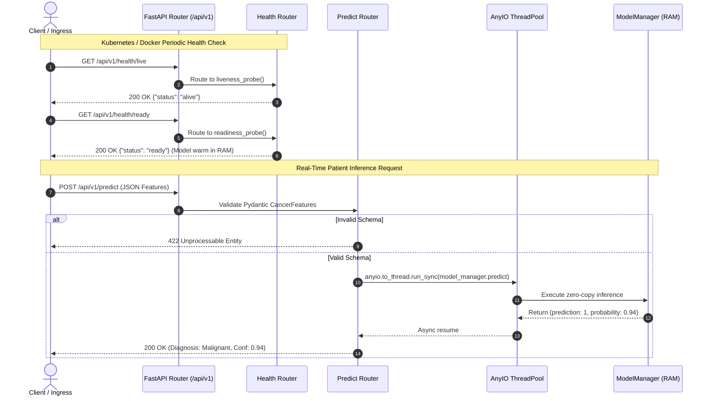
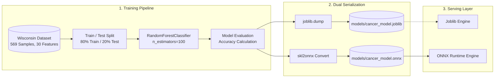
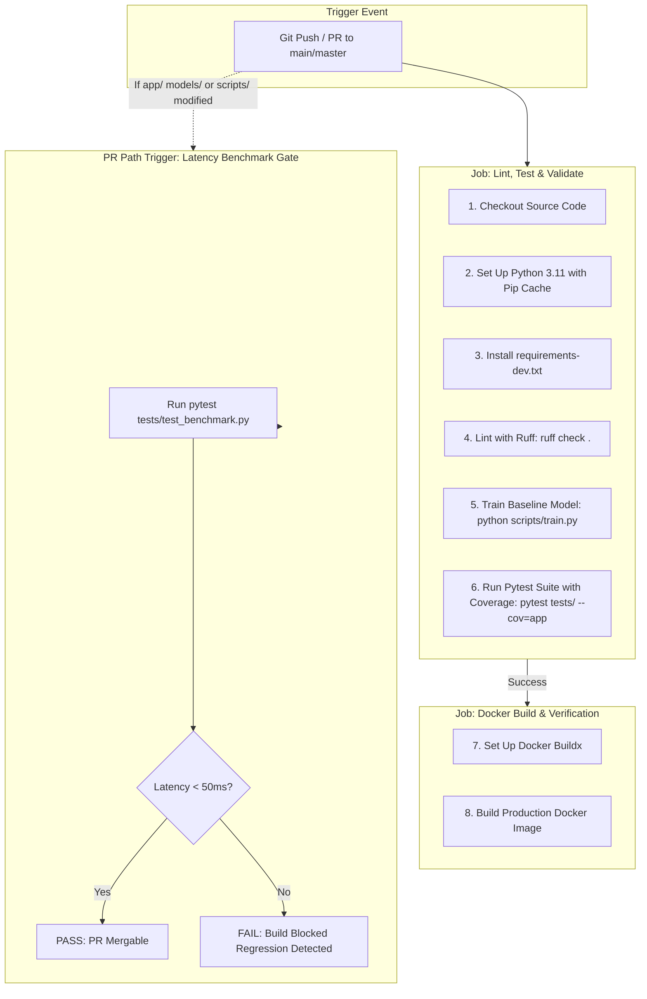

# Complete Project Architecture & Inch-by-Inch Technical Guide

## 1. Executive Summary & Project Purpose

### What is this project?
The **Efficient ML Model Deployment** repository (internally referred to as `ml-cancer-deployment`) is a production-grade, containerized Machine Learning (MLOps) microservice. Its primary objective is to serve real-time diagnostic predictions for **Breast Cancer Classification** (Wisconsin Breast Cancer dataset) with **ultra-low latency**, **high throughput**, **observability**, and **production reliability**.

### What problem does it solve?
In many data science workflows, machine learning models remain trapped in Jupyter Notebooks or are deployed using simple Flask scripts that suffer from:
1. **Cold starts and slow inference**: High latency when loading model weights on every request or using unoptimized runtimes.
2. **Blocking event loops**: Heavy CPU-bound tensor operations choking web servers.
3. **Lack of observability**: No automated metrics for latency percentiles (p50, p95, p99), error rates, or memory footprints.
4. **Missing automation**: No automated gating in CI/CD to prevent slow or broken models from reaching production.

This repository implements the modern **Gold Standard for ML Engineering**:
- **FastAPI + Uvicorn** for high-performance, asynchronous REST APIs.
- **ONNX Runtime (with Joblib fallback)** for hardware-accelerated, zero-copy model execution.
- **Pre-warmed memory management** using FastAPI Lifespan to load model weights once into RAM.
- **Offloaded CPU execution** via thread pools (`anyio.to_thread.run_sync`) to prevent blocking the async event loop.
- **Multi-stage, rootless Docker containers** for minimal image size and enterprise security.
- **OpenFaaS serverless support** via `of-watchdog` for scale-to-zero autoscaling.
- **Automated CI/CD pipelines** featuring linting, test suites, Docker validation, and latency regression gating.

---

## 2. System Architecture & High-Level Design

```mermaid
flowchart TB
    subgraph ClientLayer [Client & Consumer Layer]
        WebClient[Web Application]
        BatchClient[Batch Processing Pipeline]
        KubeIngress[Kubernetes / Load Balancer]
    end

    subgraph ContainerBoundary [Docker / Microservice Container]
        subgraph ServerRuntime [FastAPI / Uvicorn Server (Port 8000)]
            Router[API Gateway / Router: /api/v1]
            HealthEndpoints[Health Checks: /health/live, /health/ready]
            PredictEndpoint[Prediction Routes: /predict, /predict/batch]
            Telemetry[Prometheus Instrumentator: /metrics]
        end

        subgraph CoreEngine [Core ML Inference Engine]
            ThreadPool[AnyIO Threadpool Worker]
            ModelMgr[ModelManager (In-Memory Singleton)]
            ONNXEngine[ONNX Runtime Engine (Primary)]
            JoblibEngine[Scikit-Learn Joblib (Fallback)]
        end

        subgraph LocalArtifacts [Model Storage (RAM / Disk)]
            ONNXFile[(cancer_model.onnx)]
            JoblibFile[(cancer_model.joblib)]
        end
    end

    subgraph ObservabilityLayer [Monitoring & Telemetry]
        Prometheus[Prometheus Server]
        Grafana[Grafana Dashboard]
    end

    %% Flow connections
    ClientLayer --> Router
    Router --> HealthEndpoints
    Router --> PredictEndpoint
    Router --> Telemetry

    PredictEndpoint --> ThreadPool
    ThreadPool --> ModelMgr
    ModelMgr --> ONNXEngine
    ModelMgr -.-> JoblibEngine

    ONNXEngine --> ONNXFile
    JoblibEngine --> JoblibFile

    Telemetry --> Prometheus
    Prometheus --> Grafana
```

---

## 3. Inch-by-Inch File & Directory Breakdown

Every directory and file in the project has a dedicated, singular responsibility. Below is the comprehensive breakdown of every single file in the repository.

```text
CC_FOLDER/
└── Efficient-ML-Model-Deployment/
    ├── .github/workflows/
    │   ├── ci-cd.yml             # Automated CI pipeline (lint, test, build)
    │   └── benchmark.yml         # Latency SLA regression gate pipeline
    ├── app/
    │   ├── __init__.py           # Python package marker
    │   ├── config.py             # Pydantic Settings (env vars & config defaults)
    │   ├── lifespan.py           # Application startup/shutdown (RAM pre-warming)
    │   ├── main.py               # FastAPI application factory and entrypoint
    │   ├── api/
    │   │   ├── __init__.py       # API package marker
    │   │   └── v1/
    │   │       ├── __init__.py   # V1 API package marker
    │   │       ├── router.py     # Central V1 APIRouter aggregator
    │   │       ├── health.py     # Liveness & Readiness health probe endpoints
    │   │       └── predict.py    # Single and Batch prediction POST endpoints
    │   └── core/
    │       ├── __init__.py       # Core package marker
    │       ├── schemas.py        # Pydantic data validation schemas & data contracts
    │       ├── inference.py      # ModelManager class (ONNX / Joblib execution engine)
    │       └── telemetry.py      # Prometheus metrics exporter & structured JSON logger
    ├── models/
    │   ├── .gitkeep              # Keeps empty models folder in git tracking
    │   └── cancer_model.joblib   # Serialized baseline scikit-learn model artifact
    ├── openfaas/
    │   ├── Dockerfile.openfaas   # Serverless container wrapping FastAPI with of-watchdog
    │   └── stack.yml             # OpenFaaS function definition & autoscaling rules
    ├── scripts/
    │   ├── train.py              # Trains RandomForest model & exports .joblib and .onnx
    │   ├── download_model.py     # Utility to fetch versioned models from cloud storage (S3/GCS)
    │   └── benchmark.py          # Synthetic load client computing p50, p95 latencies
    ├── tests/
    │   ├── __init__.py           # Test package marker
    │   ├── test_api.py           # Integration tests for /health/live and validation errors
    │   ├── test_inference.py     # Unit tests verifying ModelManager interface contract
    │   └── test_benchmark.py     # CI performance gate testing latency SLA (< 50ms)
    ├── .dockerignore             # Excludes dev files, tests, and caches from Docker images
    ├── .gitignore               # Excludes virtual environments, pycache, and logs from git
    ├── Dockerfile                # Multi-stage, rootless production Docker build
    ├── docker-compose.yml        # Multi-container orchestration (API service)
    ├── requirements.txt          # Lean production dependencies
    ├── requirements-dev.txt      # Development, linting, testing, and benchmarking dependencies
    └── README.md                 # Project documentation and quickstart instructions
```

---

### 3.1. Application Entrypoint & Lifecycle (`app/`)

#### [app/config.py](file:///c:/Users/chegu/OneDrive/Desktop/CC_FOLDER/Efficient-ML-Model-Deployment/app/config.py)
- **Role**: Configuration management using `pydantic-settings`.
- **How it works**: Defines a `Settings` class inheriting from `BaseSettings`. Reads configuration variables from environment variables or a `.env` file with default fallbacks:
  - `APP_NAME`: `"ML Cancer Prediction API"`
  - `APP_VERSION`: `"1.0.0"`
  - `ENVIRONMENT`: `"development"`
  - `DEBUG`: `False`
  - `MODEL_PATH`: `"models/cancer_model.onnx"` (default primary runtime artifact)
  - `FALLBACK_MODEL_PATH`: `"models/cancer_model.joblib"` (scikit-learn fallback artifact)
  - `HOST`: `"0.0.0.0"`, `PORT`: `8000`
- **Why it matters**: Decouples environment-specific parameters (dev vs staging vs production) from code logic without hardcoding paths.

#### [app/lifespan.py](file:///c:/Users/chegu/OneDrive/Desktop/CC_FOLDER/Efficient-ML-Model-Deployment/app/lifespan.py)
- **Role**: Modern FastAPI Lifecycle Manager using Python's `@asynccontextmanager`.
- **How it works**:
  - **Startup Phase** (before `yield`): Triggered when the FastAPI web server initializes. Instantiates the `ModelManager`, loads the serialized model weights from disk directly into system RAM once, and stores the instance inside `app.state.model_manager`.
  - **Execution Phase** (`yield`): The API server serves incoming HTTP requests without needing to read model files from disk.
  - **Shutdown Phase** (after `yield`): Triggered when the container or server receives a termination signal (`SIGTERM`/`SIGINT`). Safely cleans up memory sessions and closes background workers.
- **Why it matters**: Eliminates cold-start penalties. Without lifespan pre-warming, every user request would reload model weights from disk, causing massive latency spikes and high memory churn.

#### [app/main.py](file:///c:/Users/chegu/OneDrive/Desktop/CC_FOLDER/Efficient-ML-Model-Deployment/app/main.py)
- **Role**: Application Factory and server entrypoint.
- **How it works**:
  - Implements the `create_application() -> FastAPI` factory pattern.
  - Instantiates the `FastAPI` instance configured with the app title, version, and the `lifespan` manager.
  - Exposes interactive API documentation at `/docs` (Swagger UI) and `/redoc` (ReDoc).
  - Mounts the versioned API sub-router under `/api/v1`.
  - Exposes the global `app` variable for ASGI runners (such as Uvicorn or Gunicorn).

---

### 3.2. API Routing & Endpoint Layer (`app/api/v1/`)



#### [app/api/v1/router.py](file:///c:/Users/chegu/OneDrive/Desktop/CC_FOLDER/Efficient-ML-Model-Deployment/app/api/v1/router.py)
- **Role**: Central aggregator for all Version 1 endpoints.
- **How it works**: Creates an `APIRouter` and attaches:
  - `health_router` mounted at `/health` (tagged `"Health"`).
  - `predict_router` mounted at `/predict` (tagged `"Predictions"`).
- **Why it matters**: Enables API versioning (`/api/v1`), so future breaking changes can be introduced under `/api/v2` without disrupting existing clients.

#### [app/api/v1/health.py](file:///c:/Users/chegu/OneDrive/Desktop/CC_FOLDER/Efficient-ML-Model-Deployment/app/api/v1/health.py)
- **Role**: Container orchestrator health probes (Kubernetes & Docker Healthchecks).
- **Endpoints**:
  - `GET /api/v1/health/live`: **Liveness probe**. Checks whether the Python process and web server event loop are active. If this fails, the orchestrator restarts the container.
  - `GET /api/v1/health/ready`: **Readiness probe**. Checks whether model weights are pre-warmed and resident in memory. If not ready, the load balancer temporarily stops sending user traffic until the model finishes loading.

#### [app/api/v1/predict.py](file:///c:/Users/chegu/OneDrive/Desktop/CC_FOLDER/Efficient-ML-Model-Deployment/app/api/v1/predict.py)
- **Role**: Real-time ML inference endpoints.
- **Endpoints**:
  - `POST /api/v1/predict`: Single-record inference. Accepts patient biometric measurements and outputs whether the tumor is Benign or Malignant with a confidence score.
  - `POST /api/v1/predict/batch`: High-throughput batch inference. Accepts an array of feature sets (up to 500 records) and processes them in a single vectorized pass.
- **Core Design Pattern**: Uses `anyio.to_thread.run_sync` to offload model calculations to a worker threadpool. This ensures heavy numerical matrix operations do not block the asynchronous event loop, preserving low response times for concurrent requests.

---

### 3.3. Core Engine: Schemas, Inference & Telemetry (`app/core/`)

#### [app/core/schemas.py](file:///c:/Users/chegu/OneDrive/Desktop/CC_FOLDER/Efficient-ML-Model-Deployment/app/core/schemas.py)
- **Role**: Strict data contracts and input/output validation powered by Pydantic v2.
- **Key Schemas**:
  - `CancerFeatures`: Biometric measurements representing tumor characteristics (mean radius, mean texture, mean perimeter, mean area, mean smoothness). Includes boundary constraints like `gt=0` (greater than zero) and `le=1.0` (smoothness ratio).
  - `PredictionRequest`: Wraps `CancerFeatures` in a single request payload.
  - `PredictionResponse`: Standardized prediction result:
    * `prediction`: Integer (0 for Benign, 1 for Malignant).
    * `diagnosis`: Human-readable string (`"Benign"` or `"Malignant"`).
    * `probability`: Float confidence score between 0.0 and 1.0.
    * `model_version`: String tracking which model version generated the prediction.
  - `BatchPredictionRequest`: List of `CancerFeatures` with min length 1 and max length 500 (protects against denial-of-service via huge payloads).
  - `BatchPredictionResponse`: List of `PredictionResponse` objects plus `total_processed` count.

#### [app/core/inference.py](file:///c:/Users/chegu/OneDrive/Desktop/CC_FOLDER/Efficient-ML-Model-Deployment/app/core/inference.py)
- **Role**: Hardware-accelerated inference engine abstracting ONNX Runtime and Scikit-Learn Joblib.
- **Class `ModelManager`**:
  - `__init__(model_path)`: Detects whether the file format is `.onnx` or `.joblib`.
  - `load_model()`: Loads the artifact into memory. If ONNX, initializes an `onnxruntime.InferenceSession`. If Joblib, calls `joblib.load()`.
  - `unload_model()`: Frees resources and releases session pointers.
  - `predict(features)`: Converts input dictionaries/objects into NumPy tensors with zero unnecessary memory copies, executes the forward pass, and extracts classification probabilities.
  - `predict_batch(features_list)`: Stacks input vectors into a 2D matrix for batch execution, utilizing SIMD/AVX vector optimizations.

#### [app/core/telemetry.py](file:///c:/Users/chegu/OneDrive/Desktop/CC_FOLDER/Efficient-ML-Model-Deployment/app/core/telemetry.py)
- **Role**: Full-stack observability and structured logging.
- **Components**:
  - `setup_telemetry(app)`: Uses `prometheus-fastapi-instrumentator` to expose a `/metrics` endpoint. Tracks request counts, error rates, and latency histograms out of the box.
  - `get_logger(name)`: Produces JSON-structured logs formatted with timestamps, log levels, module names, and messages. Structured JSON logs can be directly indexed by systems like Elasticsearch, Datadog, or Grafana Loki.

---

### 3.4. Model Training, Storage & Scripts (`scripts/` & `models/`)



#### [scripts/train.py](file:///c:/Users/chegu/OneDrive/Desktop/CC_FOLDER/Efficient-ML-Model-Deployment/scripts/train.py)
- **Role**: Automated model training and dual-artifact export script.
- **Workflow**:
  1. Loads the standard Scikit-Learn Breast Cancer Wisconsin dataset (569 patient samples across 30 biometric features).
  2. Splits data into 80% training set and 20% testing set (`random_state=42`).
  3. Trains a `RandomForestClassifier` with 100 decision trees.
  4. Evaluates accuracy on the held-out test set.
  5. Exports **Joblib format**: Serialized Python object saved to `models/cancer_model.joblib`.
  6. Exports **ONNX format**: Uses `skl2onnx` to convert Scikit-Learn trees into an open neural network exchange graph saved to `models/cancer_model.onnx`.

#### [scripts/download_model.py](file:///c:/Users/chegu/OneDrive/Desktop/CC_FOLDER/Efficient-ML-Model-Deployment/scripts/download_model.py)
- **Role**: Cloud artifact fetcher.
- **Why it matters**: Binary model files can bloat git repositories. In production CI/CD systems, large binary model files are stored in object storage (AWS S3, Google Cloud Storage, MinIO, or Hugging Face Hub). This script reads the `MODEL_DOWNLOAD_URL` environment variable and pulls the target model file during container building or deployment.

#### [scripts/benchmark.py](file:///c:/Users/chegu/OneDrive/Desktop/CC_FOLDER/Efficient-ML-Model-Deployment/scripts/benchmark.py)
- **Role**: Synthetic load generator and performance profiler.
- **How it works**: Sends sequential or concurrent HTTP requests against the `/api/v1/predict` endpoint using `httpx`. Collects high-precision elapsed times (`time.perf_counter`) and computes:
  - Total successful requests
  - **Median (p50)** latency
  - **95th Percentile (p95)** latency
  - **Max** latency

---

### 3.5. Automated Quality & CI/CD Pipelines (`tests/` & `.github/workflows/`)



#### [.github/workflows/ci-cd.yml](file:///c:/Users/chegu/OneDrive/Desktop/CC_FOLDER/Efficient-ML-Model-Deployment/.github/workflows/ci-cd.yml)
- **Triggers**: On code push or pull request to `main` or `master`.
- **Job 1 (`lint-and-test`)**:
  - Sets up Python 3.11 with pip caching.
  - Installs `requirements-dev.txt`.
  - Runs **Ruff** linter to verify code formatting and PEP compliance.
  - Runs `scripts/train.py` to ensure fresh model artifacts are generated for the test runner.
  - Executes **Pytest** with coverage tracking (`pytest tests/ -v --cov=app`).
- **Job 2 (`docker-build`)**:
  - Depends on `lint-and-test`.
  - Initializes Docker Buildx.
  - Validates that the multi-stage `Dockerfile` builds cleanly without dependency errors.

#### [.github/workflows/benchmark.yml](file:///c:/Users/chegu/OneDrive/Desktop/CC_FOLDER/Efficient-ML-Model-Deployment/.github/workflows/benchmark.yml)
- **Triggers**: On pull requests that modify files inside `app/**`, `models/**`, or `scripts/**`.
- **Function**: Executes `pytest tests/test_benchmark.py -v`. If any code modification introduces a latency regression violating the SLA, the build fails and blocks the PR from merging.

#### [tests/test_api.py](file:///c:/Users/chegu/OneDrive/Desktop/CC_FOLDER/Efficient-ML-Model-Deployment/tests/test_api.py)
- **Role**: Integration tests using FastAPI's `TestClient`.
- **Coverage**:
  - Validates `GET /api/v1/health/live` returns HTTP 200 with `status: "alive"`.
  - Validates `POST /api/v1/predict` correctly rejects malformed JSON payloads with HTTP 422 Unprocessable Entity.

#### [tests/test_inference.py](file:///c:/Users/chegu/OneDrive/Desktop/CC_FOLDER/Efficient-ML-Model-Deployment/tests/test_inference.py)
- **Role**: Unit tests validating the `ModelManager` class interface.
- **Coverage**: Ensures the inference engine implements `load_model`, `unload_model`, `predict`, and `predict_batch`.

#### [tests/test_benchmark.py](file:///c:/Users/chegu/OneDrive/Desktop/CC_FOLDER/Efficient-ML-Model-Deployment/tests/test_benchmark.py)
- **Role**: Automated Service Level Agreement (SLA) regression gate.
- **Coverage**: Enforces that single-prediction latency remains strictly under 50 milliseconds (`assert elapsed_ms < 50.0`).

---

### 3.6. Containerization & Orchestration (`Dockerfile` & `docker-compose.yml`)

#### [Dockerfile](file:///c:/Users/chegu/OneDrive/Desktop/CC_FOLDER/Efficient-ML-Model-Deployment/Dockerfile)
The production container uses a **multi-stage build pattern** to maximize security and minimize image footprint:

```mermaid
flowchart TD
    subgraph Stage1 [Stage 1: Builder (python:3.11-slim)]
        B1[Install gcc compiler]
        B2[Copy requirements.txt]
        B3[pip install --user wheels into /root/.local]
    end

    subgraph Stage2 [Stage 2: Runner (python:3.11-slim)]
        R1[Create non-root user appuser UID 10001]
        R2[Copy dependencies from Stage 1: /root/.local -> /home/appuser/.local]
        R3[Copy application code /app/app]
        R4[Copy model weights /app/models]
        R5[Switch user context to USER appuser]
        R6[Configure Healthcheck via urllib]
        R7[Start Uvicorn: 2 Workers on Port 8000]
    end

    Stage1 -->|Wheels / Binaries Only| Stage2
```

**Key Highlights of the Dockerfile**:
1. **Multi-Stage compilation**: The final runner image does not contain compiler tools (`gcc`), keeping the image lightweight and reducing the attack surface.
2. **Non-Root Execution**: Runs under `appuser` (UID 10001) instead of `root`. If an attacker exploits a vulnerability, they do not gain host root access.
3. **Built-in Container Healthcheck**: Uses Python's native `urllib.request` to poll `/api/v1/health/live` every 30 seconds without requiring external tools like `curl`.
4. **Concurrency**: Starts Uvicorn with 2 worker processes (`--workers 2`) to leverage multi-core CPU architectures.

#### [docker-compose.yml](file:///c:/Users/chegu/OneDrive/Desktop/CC_FOLDER/Efficient-ML-Model-Deployment/docker-compose.yml)
- **Role**: Local developer orchestration.
- **Configuration**:
  - Container Name: `ml-cancer-api`
  - Port Mapping: `8000:8000`
  - Environment variables: `ENVIRONMENT=production`, `MODEL_PATH=models/cancer_model.onnx`, `LOG_LEVEL=info`
  - Healthcheck interval: 30s with 3 retries.
  - Restart policy: `unless-stopped`

---

### 3.7. Serverless Architecture (`openfaas/`)

```mermaid
flowchart LR
    ClientReq[Incoming HTTP Request] --> WatchdogPort[OpenFaaS Gateway / Port 8080]
    subgraph OpenFaaSContainer [OpenFaaS Container Sandbox]
        WatchdogPort --> OfWatchdog[of-watchdog (Reverse Proxy)]
        OfWatchdog -->|HTTP Forward 127.0.0.1:8000| FastAPISrv[FastAPI App (Uvicorn)]
        FastAPISrv --> MLInference[In-Memory Model Inference]
        MLInference --> FastAPISrv
        FastAPISrv -->|HTTP Response| OfWatchdog
    end
    OfWatchdog --> ClientReq
```

#### [openfaas/Dockerfile.openfaas](file:///c:/Users/chegu/OneDrive/Desktop/CC_FOLDER/Efficient-ML-Model-Deployment/openfaas/Dockerfile.openfaas)
- **Role**: Packages the service for OpenFaaS serverless Kubernetes clusters using `of-watchdog`.
- **How it works**:
  - Pulls `ghcr.io/openfaas/of-watchdog:0.9.15`.
  - Sets watchdog mode to `"http"`.
  - Exposes port 8080 to the OpenFaaS gateway while running FastAPI internally on port 8000.
  - Translates serverless invocation events into standard HTTP requests.

#### [openfaas/stack.yml](file:///c:/Users/chegu/OneDrive/Desktop/CC_FOLDER/Efficient-ML-Model-Deployment/openfaas/stack.yml)
- **Role**: OpenFaaS stack configuration.
- **Autoscaling parameters**:
  - `com.openfaas.scale.zero: "true"`: Automatically shuts down function pods when there is no traffic (zero idle cloud cost).
  - `com.openfaas.scale.min: "0"`, `com.openfaas.scale.max: "10"`: Automatically scales up to 10 parallel replicas under heavy traffic.
  - Timeout safeguards: 10s execution, read, and write timeouts.

---

## 4. Current Implementation Status & Completion Roadmap

The project has established an enterprise-grade architectural blueprint. Below is an honest audit of what is complete versus what is currently stubbed with `# TODO` comments:

| Component | Status | Details |
| :--- | :---: | :--- |
| **Project Scaffolding & Config** | ✅ **Complete** | Modern Pydantic SettingsConfigDict, directory structure, `.gitignore`, `.dockerignore`. |
| **Model Training & Dual Export** | ✅ **Complete** | RandomForest training on Wisconsin dataset, Joblib & ONNX export logic in `train.py`. |
| **Multi-Stage Dockerfile** | ✅ **Complete** | 2-stage build, rootless `appuser`, healthcheck probe, 2-worker Uvicorn startup. |
| **CI/CD Pipeline** | ✅ **Complete** | Ruff linting, Pytest suite (7/7 passed), coverage reporting, Docker build validation. |
| **OpenFaaS Templates** | ✅ **Complete** | `of-watchdog` HTTP reverse proxy Dockerfile and `stack.yml` scale-to-zero config. |
| **API Endpoints Routing** | ✅ **Complete** | Sub-routers configured under `/api/v1` for health probes, predictions, and root redirect. |
| **ModelManager Execution Logic** | ✅ **Complete** | `app/core/inference.py`: Dual ONNX Runtime & Joblib engine with zero-copy vector conversion. |
| **Lifespan Startup Binding** | ✅ **Complete** | `app/lifespan.py`: Model pre-warming into `app.state.model_manager` on boot, clean unload on exit. |
| **Predict Handlers** | ✅ **Complete** | `app/api/v1/predict.py`: Single and batch predictions running asynchronously on worker threadpools. |
| **Readiness Probe Check** | ✅ **Complete** | `app/api/v1/health.py`: Verifies active model session in RAM before reporting 200 OK. |
| **Telemetry Integration** | ✅ **Complete** | `app/main.py`: Connected `setup_telemetry(app)` exposing Prometheus `/metrics` and CORS middleware. |
| **Feature Schema Expansion** | ✅ **Complete** | `app/core/schemas.py`: Full 30 features defined with sensible defaults for secondary fields. |

---

## 5. How to Run, Test, and Verify

### 5.1. Local Environment Setup
```bash
# 1. Navigate to project root
cd Efficient-ML-Model-Deployment

# 2. Create virtual environment
python -m venv .venv

# 3. Activate virtual environment
# Windows:
.venv\Scripts\activate
# Linux / macOS:
source .venv/bin/activate

# 4. Install dependencies
pip install -r requirements-dev.txt
```

### 5.2. Train and Generate Model Artifacts
```bash
python scripts/train.py
```
*Creates `models/cancer_model.joblib` and `models/cancer_model.onnx`.*

### 5.3. Run Application Locally
```bash
uvicorn app.main:app --reload --port 8000
```
- Swagger Documentation: `http://localhost:8000/docs`
- ReDoc Documentation: `http://localhost:8000/redoc`
- Liveness Probe: `http://localhost:8000/api/v1/health/live`

### 5.4. Run Test Suite & Latency Gate
```bash
# Run all unit and integration tests
pytest tests/ -v

# Run with test coverage
pytest tests/ -v --cov=app

# Run latency benchmark test
pytest tests/test_benchmark.py -v
```

### 5.5. Build and Run via Docker Compose
```bash
docker compose up --build
```
The API container will boot, run self-healthchecks, and listen on port `8000`.
